<h1 align=center>VWCO – Migração de Dados do Jira</h1>

<p align="center">
  
</p>

---

## Sumário

A automação **Jira ITG Migration** foi criada para extrair, preservar e organizar o acervo histórico atualmente mantido no Jira On-Premises, considerando a necessidade de transição para novas soluções corporativas e a preservação das informações críticas utilizadas por Tecnologia da Informação, Compras e áreas relacionadas ao controle de testes de caminhão.

O objetivo principal é evitar perda de histórico, reduzir dependência do acesso direto ao Jira legado e garantir que informações relevantes permaneçam disponíveis para consulta, auditoria, análise operacional, reconstrução de histórico e suporte à migração para novas soluções.

A automação foi estruturada para extrair dados por atuação:

- `ITG`
- `FT`
- `FTB`
- `ML`

A solução organiza a extração por pasta, issue, anexos, logs, controles e evidências de integridade.

---

## Contexto

O Jira concentra informações relevantes para processos de TI e áreas relacionadas. Considerando o desligamento planejado do ambiente legado, existe risco organizacional de perda ou indisponibilidade de histórico caso os dados não sejam extraídos, organizados e preservados previamente.

Entre os conteúdos críticos mantidos no Jira estão:

- Histórico de projetos de TI.
- Solicitações de compras de TI.
- Demandas relacionadas a serviços.
- Demandas relacionadas a materiais.
- Demandas relacionadas a licenças.
- Anexos técnicos e comerciais.
- Comentários utilizados como histórico e comunicação interna.
- Controle de status e etapas do processo.
- Evidências de aprovações, pendências, tratativas e alterações.
- Informações relacionadas ao controle de testes de caminhão.

Dessa forma, a automação não deve ser tratada apenas como uma rotina técnica de extração, mas como uma ação de preservação de acervo corporativo.

---

## Justificativa

A extração do acervo histórico do Jira é necessária porque parte relevante da memória operacional da organização está registrada no sistema legado. Caso o Jira seja desligado sem uma extração adequada, a organização pode perder acesso prático a dados importantes para:

- Consultas históricas de projetos.
- Comprovação de solicitações de compras.
- Análise de serviços contratados.
- Consulta de materiais solicitados.
- Consulta de licenças e suas justificativas.
- Rastreabilidade de aprovações e decisões.
- Apuração de pendências antigas.
- Evidências para auditoria.
- Reconstrução de histórico de demandas.
- Continuidade de processos que dependem de registros anteriores.
- Análises futuras em Power BI ou outras ferramentas de BI.

A automação atua, portanto, como mecanismo de redução de risco operacional, documental e de auditoria.

---

## Atuação e Gestão da Iniciativa

Além do desenvolvimento da automação de migração, fui responsável pela **gestão e coordenação da iniciativa de transição do Jira**, acompanhando as diferentes frentes necessárias para preservação do histórico, substituição dos processos ativos e descomissionamento do ambiente legado.

A iniciativa envolveu **CoE de Power Platform, CoE de Dados, Infraestrutura de TI e áreas de negócio**, com atuação integrada entre os times.

Minhas principais responsabilidades foram:

- Gestão e coordenação geral da iniciativa.
- Planejamento e acompanhamento das entregas.
- Coordenação das dependências entre os times.
- Acompanhamento de cronograma, riscos e impedimentos.
- Alinhamento entre equipes técnicas e áreas de negócio.
- Desenvolvimento e homologação da automação Python para migração do Jira.
- Coordenação da estratégia de preservação do acervo histórico.
- Atuação como **Product Owner (PO)** do Hub de Compras.
- Coordenação de requisitos e validações com o CoE de Power Platform.
- Acompanhamento da disponibilização do histórico no Power BI junto ao CoE de Dados.
- Coordenação das dependências com Infraestrutura de TI.
- Acompanhamento da migração dos processos em andamento.
- Coordenação da transição para as novas soluções.
- Acompanhamento do Go-Live e do descomissionamento do ambiente legado.

### Entregas Integradas

A iniciativa foi estruturada em quatro frentes principais:

| Frente | Entrega |
|---|---|
| **Migração do Jira** | Automação Python para extração, organização e preservação do histórico |
| **Hub de Compras** | Nova solução para substituir o processo de Compras de TI anteriormente mantido no Jira ITG |
| **CoE de Dados / Power BI** | Disponibilização do histórico migrado para consulta |
| **Infraestrutura de TI** | Suporte ao processamento, armazenamento e descomissionamento do ambiente legado |

### Hub de Compras – CoE de Power Platform

Atuei como **Product Owner (PO)** do Hub de Compras, solução criada para substituir o processo de solicitações de Compras de TI anteriormente suportado pelo Jira ITG.

A frente contemplou:

- Levantamento e consolidação de requisitos.
- Definição do processo futuro (`To Be`).
- Construção e validação de User Stories.
- Definição de critérios de aceite.
- Construção do Dicionário de Dados.
- Definição de perfis e regras funcionais.
- Acompanhamento das Sprints.
- Validação funcional.
- Migração das solicitações em andamento.
- Entrada em produção da nova solução.

### Histórico Jira – CoE de Dados / Power BI

Em conjunto com o **CoE de Dados**, coordenei a frente responsável por disponibilizar o histórico preservado pela migração para consulta por meio do Microsoft Power BI.

O objetivo foi manter o acesso às informações históricas mesmo após o desligamento do Jira legado.

### Infraestrutura de TI

Também coordenei as dependências com a **Infraestrutura de TI** relacionadas à execução da migração, armazenamento do acervo histórico, disponibilização dos dados e preparação para o desligamento do ambiente Jira.

### Resultado

A gestão integrada dessas frentes permitiu tratar a transição do Jira de ponta a ponta:

1. **Preservação** do histórico por meio da automação Python.
2. **Migração** dos processos ainda em andamento.
3. **Substituição** do Jira ITG pelo Hub de Compras.
4. **Disponibilização** do histórico no Power BI.
5. **Adequação** da infraestrutura para armazenamento e consulta.
6. **Descomissionamento** do ambiente legado após a conclusão da transição.
---

## Objetivo da Automação

A automação tem como objetivo realizar a extração estruturada de dados do Jira, gerando uma base organizada e auditável para preservação do histórico.

Objetivos específicos:

- Extrair issues por atuação.
- Preservar dados principais da demanda.
- Preservar campos brutos retornados pela API.
- Preservar campos renderizados.
- Preservar comentários.
- Preservar worklogs.
- Preservar histórico de alterações/changelog.
- Preservar anexos.
- Gerar controle de progresso.
- Permitir retomada após falhas ou interrupções.
- Gerar logs por execução.
- Gerar hashes SHA256 para evidência de integridade.
- Apoiar auditorias e consultas futuras.
- Apoiar estruturação de acervo para BI e futuras migrações.

---

## Escopo da Extração

A automação permite a seleção da atuação desejada no início da execução:

```text
ITG
FT
FTB
ML
```

Cada atuação possui:

- Pasta própria.
- Arquivo de controle próprio.
- Logs próprios.
- Issues próprias.
- Histórico próprio.

Essa separação evita mistura de dados e facilita análise posterior por área, processo ou tipo de demanda.

---

## Visão Geral da Solução

A automação executa o seguinte ciclo:

1. Carrega configurações do projeto.
2. Valida variáveis de ambiente obrigatórias.
3. Exibe menu para seleção da atuação.
4. Cria estrutura de pastas.
5. Cria arquivo de log da execução.
6. Conecta ao Jira.
7. Busca as issues pela JQL da atuação.
8. Cria ou atualiza o arquivo de controle.
9. Lê o progresso anterior.
10. Identifica issues pendentes.
11. Processa as issues de forma sequencial ou paralela.
12. Extrai campos principais.
13. Extrai campos brutos e renderizados.
14. Extrai comentários paginados.
15. Extrai worklogs paginados.
16. Extrai histórico de alterações.
17. Gera Excel da issue.
18. Baixa anexos, se habilitado.
19. Gera hashes de integridade.
20. Atualiza o relatório de migração.
21. Marca a issue como `Migrated` ou `Failed`.
22. Finaliza a execução com log completo.

---

## Fluxo da Automação

```mermaid
flowchart TD
    A[Início da execução] --> B[Carregar configurações]
    B --> C[Validar variáveis de ambiente]
    C --> D[Exibir menu de atuação]
    D --> E{Atuação selecionada?}
    E -->|Não| F[Encerrar execução]
    E -->|Sim| G[Criar estrutura de pastas]
    G --> H[Criar log TXT]
    H --> I[Conectar ao Jira]
    I --> J{Modo issue única?}
    J -->|Sim| K[Buscar issue específica]
    J -->|Não| L[Executar JQL da atuação]
    K --> M[Criar ou atualizar controle]
    L --> M[Criar ou atualizar controle]
    M --> N[Ler Progress Control]
    N --> O[Filtrar issues não Migrated]
    O --> P{Existem pendências?}
    P -->|Não| Q[Registrar conclusão sem pendências]
    P -->|Sim| R{Paralelismo habilitado?}
    R -->|Não| S[Processamento sequencial]
    R -->|Sim| T[Processamento paralelo por workers]
    S --> U[Marcar issue como In Progress]
    T --> U[Marcar issue como In Progress]
    U --> V[Extrair Overview]
    V --> W[Extrair Fields]
    W --> X[Extrair Rendered Fields]
    X --> Y[Extrair Comments]
    Y --> Z[Extrair Worklogs]
    Z --> AA[Extrair Activities/Changelog]
    AA --> AB[Gerar Excel da issue]
    AB --> AC{JSON bruto habilitado?}
    AC -->|Sim| AD[Gerar Raw JSON]
    AC -->|Não| AE[Ignorar Raw JSON]
    AD --> AF{Download de anexos habilitado?}
    AE --> AF{Download de anexos habilitado?}
    AF -->|Sim| AG[Baixar anexos]
    AF -->|Não| AH[Ignorar anexos]
    AG --> AI[Gerar hashes dos anexos]
    AH --> AI[Gerar hashes dos anexos]
    AI --> AJ[Gerar hashes do Excel e JSON]
    AJ --> AK[Atualizar Migration Report]
    AK --> AL{Sucesso?}
    AL -->|Sim| AM[Marcar como Migrated]
    AL -->|Não| AN[Marcar como Failed]
    AM --> AO[Finalizar execução]
    AN --> AO[Finalizar execução]
    Q --> AO[Finalizar execução]
```



---

## Impacto Organizacional

### Preservação do Acervo Histórico

O principal impacto da automação é preservar o histórico operacional registrado no Jira antes da indisponibilidade do ambiente legado.

Isso reduz o risco de perda de:

- Histórico de projetos de TI.
- Solicitações de compras de TI.
- Registros de serviços contratados.
- Registros de materiais solicitados.
- Registros de licenças.
- Comentários usados como trilha de comunicação.
- Anexos usados como evidência de demanda, proposta, memorial ou aprovação.
- Histórico de alterações e mudanças de status.
- Informações relacionadas aos controles de testes de caminhão.

Sem a extração, parte desse histórico pode se tornar inacessível ou depender de backups técnicos de difícil consulta para usuários de negócio.

### Continuidade Operacional

A automação contribui para a continuidade operacional porque transforma dados do Jira em arquivos estruturados e consultáveis.

Impactos esperados:

- Facilita consulta posterior ao histórico.
- Reduz dependência do acesso ao Jira legado.
- Apoia a transição para novas aplicações.
- Permite validação de campos antes da migração definitiva.
- Apoia identificação de lacunas entre o processo atual e a nova solução.
- Reduz perda de conhecimento operacional.

### Auditoria e Compliance

A automação fortalece auditoria porque registra evidências estruturadas por issue.

Impactos esperados:

- Preservação de comentários.
- Preservação de anexos.
- Preservação de histórico de alteração.
- Preservação de worklogs, quando existentes.
- Registro da JQL usada.
- Registro da versão do script.
- Registro da quantidade de workers usada.
- Registro de hash SHA256 para validação de integridade.
- Log TXT de execução.
- Rastreamento do status de cada issue extraída.

Esses elementos permitem demonstrar quando, como e com qual configuração os dados foram extraídos.

### Gestão de Compras de TI

A automação tem impacto direto sobre o histórico de compras de TI porque preserva solicitações relacionadas a:

- Serviços.
- Materiais.
- Licenças.
- Fonte única.
- Fonte restrita.
- Centros de custo.
- Valores.
- Moedas.
- Fornecedores.
- Justificativas.
- Anexos de apoio.
- Comentários de tratativa.

Essa preservação é relevante para análises futuras, conferências internas, reconstrução de processos e suporte a auditorias.

### Gestão de Projetos de TI (Legado)

A automação apoia a preservação do histórico de projetos de TI ao manter:

- Nome da demanda.
- Status.
- Responsável.
- Solicitante.
- Descrição.
- Prioridade.
- Histórico de alterações.
- Comentários.
- Anexos.

Isso facilita consulta futura sobre decisões, andamento, pendências, alterações e contexto das demandas.

### Controle de Testes de Caminhão

Considerando que parte do controle de testes de caminhão também está registrada no ecossistema Jira, a automação contribui para preservar informações que podem ser necessárias para rastreabilidade técnica, histórico de execução e acompanhamento de demandas relacionadas.

A extração ajuda a reduzir o risco de perda de informações técnicas vinculadas a testes, registros históricos, anexos e comentários operacionais.

---

## Riscos Mitigados

| Risco | Como a automação mitiga |
|---|---|
| Perda de histórico após desligamento do Jira | Extrai e organiza dados antes da indisponibilidade do sistema. |
| Dificuldade de consulta futura | Gera arquivos organizados por atuação e issue. |
| Perda de anexos | Baixa anexos e registra hashes. |
| Perda de comentários | Extrai comentários por paginação. |
| Perda de trilha de alterações | Exporta activities/changelog. |
| Falha em execução longa | Usa controle de progresso e retomada automática. |
| Exposição de senha | Usa variáveis de ambiente em vez de senha no código. |
| Baixa rastreabilidade da extração | Gera log TXT, relatório de migração e hashes. |
| Sobrecarga de execução | Usa workers controlados por limite seguro. |

---

## Configuração das Variáveis de Ambiente

As credenciais devem ser configuradas no Windows, fora do código-fonte.

Modelo recomendado:

```powershell
[System.Environment]::SetEnvironmentVariable("JIRA_USERNAME", "_ISUARIO", "User")
[System.Environment]::SetEnvironmentVariable("JIRA_PASSWORD", "_SENHA", "User")
[System.Environment]::SetEnvironmentVariable("JIRA_URL", "_URL", "User")
```

Configuração recomendada de saída:

```powershell
[System.Environment]::SetEnvironmentVariable("JIRA_OUTPUT_FOLDER", "C:\Temp", "User")
```

Configuração recomendada de paralelismo:

```powershell
[System.Environment]::SetEnvironmentVariable("JIRA_MAX_WORKERS", "5", "User")
[System.Environment]::SetEnvironmentVariable("JIRA_SAFE_MAX_WORKERS_LIMIT", "10", "User")
```

Configuração recomendada de segurança:

```powershell
[System.Environment]::SetEnvironmentVariable("JIRA_CREATE_RAW_JSON", "false", "User")
[System.Environment]::SetEnvironmentVariable("JIRA_VERIFY_SSL", "true", "User")
```

---

## Preparação do Ambiente

Acesse a pasta do projeto

Crie o ambiente virtual:

```powershell
py -m venv .venv
```

Instale as dependências:

```powershell
.\.venv\Scripts\python.exe -m pip install --upgrade pip
.\.venv\Scripts\python.exe -m pip install -r requirements.txt
```

Execute o projeto:

```powershell
.\.venv\Scripts\python.exe main.py
```

---

## Estrutura de Saída

Exemplo:

```text
C:\Temp
└── JIRA-MIGRATION
    └── ITG
        ├── 00-Control
        │   ├── ITG_Control.xlsx
        │   └── ITG_YYYYMMDD_HHMMSS_Execution-Log.txt
        └── 01-Issues
            └── ITG-122-Nome-da-Issue
                ├── 01-Data
                │   ├── ITG-122-Nome-da-Issue_Issue_Data.xlsx
                │   └── ITG-122-Nome-da-Issue_Attachment_Hashes.txt
                └── 02-Attachments
                    └── anexos baixados
```

---

## Arquivo de Controle

Cada atuação possui um arquivo de controle próprio:

```text
ITG_Control.xlsx
FT_Control.xlsx
FTB_Control.xlsx
ML_Control.xlsx
```

Abas:

```text
Found Issues
Progress Control
Migration Report
```

---

## Retomada Automática

A automação retoma a execução com base no status da aba `Progress Control`.

| Status | Comportamento |
|---|---|
| Migrated | Não processa novamente |
| Pending | Processa |
| In Progress | Processa novamente |
| Failed | Processa novamente |

Esse comportamento permite interromper a execução e continuar posteriormente sem perder o progresso.

---

## Boas Práticas de Execução

- Validar primeiro com uma única issue.
- Gerar os arquivos em pasta local.
- Evitar execução direta em OneDrive durante extrações grandes.
- Começar com `JIRA_MAX_WORKERS=5`.
- Aumentar workers somente após validar estabilidade.
- Manter JSON bruto desligado, salvo necessidade controlada.
- Validar o arquivo de controle ao fim da execução.
- Preservar o log TXT junto ao controle.
- Proteger os arquivos extraídos conforme a classificação da informação.

---

## Tecnologias, Bibliotecas e Dependências

### Tecnologias Principais

| Tecnologia | Versão Recomendada | Finalidade |
|---|---:|---|
| Python | 3.11+ | Linguagem principal utilizada para construção da automação |
| Jira REST API | Jira On-Premises | Consulta de issues, campos, comentários, worklogs, changelog e anexos |
| PowerShell | 5.1+ | Configuração de variáveis de ambiente e execução de comandos locais |
| Windows | 11 | Sistema operacional utilizado para execução da automação |
| Microsoft Excel | 365 | Consulta e análise dos arquivos `.xlsx` gerados pela extração |
| Markdown | Compatível com GitHub | Documentação técnica do projeto |

---

### Ferramentas de Desenvolvimento

| Ferramenta | Versão | Uso Principal |
|---|---:|---|
| PyCharm | 2026.1 | Desenvolvimento, execução, depuração e manutenção do projeto Python |
| Git | 2.0+ | Controle de versão do código-fonte |
| GitHub | Web | Armazenamento e versionamento do repositório |
| PowerShell | 5.1+ | Criação do ambiente virtual, instalação de dependências e configuração local |
| Python Virtual Environment | `.venv` | Isolamento das bibliotecas utilizadas pelo projeto |
| Microsoft Excel | 365 | Validação dos arquivos de controle, relatórios e evidências extraídas |

---

### Bibliotecas Python

| Biblioteca | Versão Recomendada | Tipo | Finalidade |
|---|---:|---|---|
| `jira` | Atual estável | Integração | Conexão, autenticação e consulta ao Jira On-Premises |
| `requests` | Atual estável | HTTP | Requisições auxiliares para comentários, worklogs e anexos |
| `urllib3` | Atual estável | HTTP/Suporte | Suporte de comunicação HTTP utilizado por dependências |
| `openpyxl` | Atual estável | Excel | Criação, atualização e formatação de arquivos `.xlsx` |
| `hashlib` | Nativa do Python | Segurança/Integridade | Geração de hash SHA256 dos arquivos extraídos |
| `json` | Nativa do Python | Serialização | Tratamento e exportação de dados retornados pela API |
| `pathlib` | Nativa do Python | Arquivos/Pastas | Manipulação de caminhos, diretórios e arquivos |
| `datetime` | Nativa do Python | Data/Hora | Registro de timestamps em logs, controles e relatórios |
| `concurrent.futures` | Nativa do Python | Paralelismo | Execução paralela de extrações por meio de workers |
| `threading` | Nativa do Python | Controle | Controle de escrita concorrente em arquivos de controle |
| `re` | Nativa do Python | Tratamento de texto | Sanitização de nomes de arquivos e pastas |
| `html` | Nativa do Python | Tratamento de texto | Limpeza de conteúdo HTML retornado pelo Jira |
| `os` | Nativa do Python | Ambiente | Leitura de variáveis de ambiente |
| `socket` | Nativa do Python | Rede | Validação de resolução DNS do host Jira |
| `time` | Nativa do Python | Execução | Controle de espera entre tentativas de retry/backoff |

---

### Dependências de Ambiente

| Dependência | Versão / Configuração | Tipo | Observações |
|---|---:|---|---|
| Python instalado | 3.11+ | Ambiente | Necessário para criar o ambiente virtual e executar o projeto |
| Ambiente virtual `.venv` | Criado localmente | Ambiente | Deve ser recriado na máquina do usuário e não deve ser versionado |
| Acesso ao Jira On-Premises | Conforme perfil do usuário | Segurança | O usuário deve possuir permissão para consultar issues, comentários, anexos e histórico |
| Variáveis de ambiente | Obrigatórias | Segurança | Utilizadas para manter credenciais fora do código-fonte |
| Conexão com rede corporativa/VPN | Conforme ambiente | Infraestrutura | Necessária para acesso ao Jira interno |
| Permissão de escrita em disco | Necessária | Ambiente | A automação cria pastas, Excel, logs, anexos e arquivos de hash |
| Pasta de saída local | `C:\Temp` | Performance | Recomendada para evitar lentidão causada por sincronização do OneDrive |
| Certificado SSL | Preferencialmente válido | Segurança | Recomenda-se manter a validação SSL habilitada sempre que possível |
